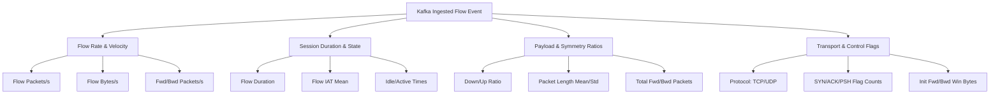

# Exploratory Data Analysis (EDA) Report
## Real-Time Cyber Security Log Correlation Using Apache Kafka

---

## 1. Dataset Description

This exploratory data analysis evaluates the benchmark cybersecurity network-flow dataset comprising 8 distinct Parquet captures corresponding to individual days and attack profiles from the CIC-IDS2017 collection. The primary objective of this EDA is to characterize network traffic behavior, baseline flow metrics, quantify attack profiles, assess data hygiene (missing values, duplicates, distributions), and derive architectural insights for ingesting, replaying, and correlating security events in real-time using Apache Kafka.

Each capture represents network traffic recorded under controlled network topologies featuring victim subnets, attacker infrastructure, and background benign user behavior. The captures provide extensive statistical network-flow characteristics extracted across bidirectional network sessions.

---

## 2. Dataset Inventory

The dataset comprises **8 Parquet files** with zero file corruption and fully consistent schemas across all captures.

| Dataset File | Inferred Category | Row Count | Column Count | File Size (MB) | File Size (Bytes) |
|:---|:---|---:|---:|---:|---:|
| `Benign-Monday-no-metadata.parquet` | **Benign** | 458,831 | 78 | 54.14 | 56,765,918 |
| `Botnet-Friday-no-metadata.parquet` | **Botnet** | 176,038 | 78 | 18.94 | 19,855,151 |
| `Bruteforce-Tuesday-no-metadata.parquet` | **Brute Force** | 389,714 | 78 | 44.00 | 46,140,640 |
| `DDoS-Friday-no-metadata.parquet` | **DDoS** | 221,264 | 78 | 24.13 | 25,302,305 |
| `DoS-Wednesday-no-metadata.parquet` | **DoS** | 584,991 | 78 | 65.04 | 68,198,756 |
| `Infiltration-Thursday-no-metadata.parquet` | **Infiltration** | 207,630 | 78 | 22.07 | 22,070,000 |
| `Portscan-Friday-no-metadata.parquet` | **Port Scan** | 119,522 | 78 | 12.96 | 13,594,122 |
| `WebAttacks-Thursday-no-metadata.parquet` | **Web Attacks** | 155,820 | 78 | 16.84 | 17,652,834 |
| **Total / Combined** | **All Categories** | **2,313,810** | **78** | **258.12** | **270,670,410** |

*All inventory calculations were generated programmatically and saved to `dataset_summary.csv`.*

---

## 3. Dataset Size & Schema Overview

- **Total Combined Records:** `2,313,810` network flow events
- **Total Ingestion Size:** `258.12 MB` (Compressed Parquet format)
- **Original Features per Record:** `78`
- **Analysis Features (with derived columns):** `80` (adding `category` and `traffic_type`)
- **Memory Footprint (Uncompressed DataFrame):** ~1.42 GB

---

## 4. Feature Description & Taxonomy

The 78 original features represent detailed bidirectional flow statistics computed by network flow extraction engines (e.g., CICFlowMeter):

1. **Protocol & Identification:** `Protocol` (Transport layer protocol: 6 for TCP, 17 for UDP, 0 for ICMP/HOPOPT).
2. **Temporal & Duration Metrics:** `Flow Duration`, `Flow IAT Mean`, `Flow IAT Std`, `Flow IAT Max`, `Flow IAT Min`, `Fwd IAT Total`, `Fwd IAT Mean`, `Fwd IAT Std`, `Fwd IAT Max`, `Fwd IAT Min`, `Bwd IAT Total`, `Bwd IAT Mean`, `Bwd IAT Std`, `Bwd IAT Max`, `Bwd IAT Min`, `Active Mean`, `Active Std`, `Active Max`, `Active Min`, `Idle Mean`, `Idle Std`, `Idle Max`, `Idle Min`.
3. **Volume & Throughput Metrics:** `Total Fwd Packets`, `Total Backward Packets`, `Fwd Packets Length Total`, `Bwd Packets Length Total`, `Flow Bytes/s`, `Flow Packets/s`, `Fwd Packets/s`, `Bwd Packets/s`, `Subflow Fwd Packets`, `Subflow Fwd Bytes`, `Subflow Bwd Packets`, `Subflow Bwd Bytes`.
4. **Packet Size Statistics:** `Fwd Packet Length Max/Min/Mean/Std`, `Bwd Packet Length Max/Min/Mean/Std`, `Packet Length Min/Max/Mean/Std/Variance`, `Avg Packet Size`, `Avg Fwd Segment Size`, `Avg Bwd Segment Size`, `Fwd Seg Size Min`.
5. **TCP Control Flags & Windowing:** `FIN Flag Count`, `SYN Flag Count`, `RST Flag Count`, `PSH Flag Count`, `ACK Flag Count`, `URG Flag Count`, `CWE Flag Count`, `ECE Flag Count`, `Fwd PSH Flags`, `Bwd PSH Flags`, `Fwd URG Flags`, `Bwd URG Flags`, `Init Fwd Win Bytes`, `Init Bwd Win Bytes`.
6. **Bulk & Segment Metrics:** `Fwd/Bwd Avg Bytes/Bulk`, `Fwd/Bwd Avg Packets/Bulk`, `Fwd/Bwd Avg Bulk Rate`, `Fwd Act Data Packets`, `Down/Up Ratio`.
7. **Ground Truth Label:** `Label` (Categorical ground-truth classification).

---

## 5. Class & Traffic Type Distribution

### 5.1 Category Distribution (Derived from File Captures)

| Category | Record Count | Percentage of Total (%) | Cumulative (%) |
|:---|---:|---:|---:|
| **DoS** | 584,991 | 25.28% | 25.28% |
| **Benign** | 458,831 | 19.83% | 45.11% |
| **Brute Force** | 389,714 | 16.84% | 61.95% |
| **DDoS** | 221,264 | 9.56% | 71.52% |
| **Infiltration** | 207,630 | 8.97% | 80.49% |
| **Botnet** | 176,038 | 7.61% | 88.10% |
| **Web Attacks** | 155,820 | 6.73% | 94.83% |
| **Port Scan** | 119,522 | 5.17% | 100.00% |
| **Total** | **2,313,810** | **100.00%** | — |

### 5.2 High-Level Traffic Type

| Traffic Type | Record Count | Percentage (%) |
|:---|---:|---:|
| **Attack** | 1,854,979 | 80.17% |
| **Benign** | 458,831 | 19.83% |
| **Total** | **2,313,810** | **100.00%** |

### 5.3 Granular Ground-Truth `Label` Column Distribution

Within each attack capture file, traffic contains both benign background traffic and active malicious sessions:

| Granular Label | Total Flow Records | Dominant Attack Category |
|:---|---:|:---|
| **Benign** | 1,977,318 | Normal Background Flow |
| **DoS Hulk** | 172,846 | DoS Attack |
| **DDoS** | 128,014 | DDoS Attack |
| **DoS GoldenEye** | 10,286 | DoS Attack |
| **FTP-Patator** | 5,931 | Brute Force Attack |
| **DoS slowloris** | 5,385 | DoS Attack |
| **DoS Slowhttptest** | 5,228 | DoS Attack |
| **SSH-Patator** | 3,219 | Brute Force Attack |
| **PortScan** | 1,956 | Port Scanning Reconnaissance |
| **Web Attack – Brute Force** | 1,470 | Web Application Attack |
| **Bot** | 1,437 | Botnet Command & Control |
| **Web Attack – XSS** | 652 | Web Application Attack |
| **Infiltration** | 36 | Lateral Infiltration |
| **Web Attack – Sql Injection** | 21 | Web Application Attack |
| **Heartbleed** | 11 | OpenSSL Exploit |

*Visual representations saved:*
- `plots/category_distribution.png`: Bar chart of events by file category.
- `plots/benign_vs_attack.png`: Pie chart of Benign vs Attack classification.
- `plots/attack_distribution.png`: Distribution of attack categories excluding pure Benign capture.

---

## 6. Missing Value Analysis

A comprehensive null/NaN scan across all 2,313,810 rows and 80 features revealed:

- **Total Missing Values Detected:** **0**
- **Features with Missing Values:** **0 out of 80 (0.00%)**
- **Missing Value Assessment:** **"No missing values detected across all features."**

*The complete feature-by-feature null audit is stored in `missing_values.csv`.*

---

## 7. Duplicate Record Analysis

- **Total Identical Rows (Original 78 Features):** `82,004`
- **Duplicate Percentage:** `3.54%`
- **Security Assessment & Handling Decision:** 
  Duplicates were **strictly preserved** in accordance with project requirements. In network telemetry and security logging, identical flow metric records naturally occur when automated tools perform high-frequency probing (e.g., repeated TCP SYN scans to closed ports, periodic NTP/DNS heartbeat requests, or fixed-rate DoS floods). Eliminating duplicates would distort the true flow event volume necessary for accurate rate-based stream correlation.

---

## 8. Data Type Analysis

The combined schema is structured into the following data type distribution:

| Type Category | Count | Example Features |
|:---|---:|:---|
| **Numerical (`int8`, `int16`, `int32`, `float32`, `float64`)** | **77** | `Protocol`, `Flow Duration`, `Total Fwd Packets`, `Flow Bytes/s`, `Packet Length Mean` |
| **Categorical / Object (`string`, `category`)** | **3** | `Label`, `category`, `traffic_type` |
| **Datetime / Temporal** | **0** | *(No timestamp column in `no-metadata` Parquet captures)* |

---

## 9. Descriptive Statistics & Numerical Feature Analysis

Key statistical properties of the top network flow metrics (calculated across all 2,313,810 records):

| Feature | Mean | Std Dev | Min | 25% | Median | 75% | Max |
|:---|---:|---:|---:|---:|---:|---:|---:|
| **Protocol** | 10.51 | 5.42 | 0 | 6.00 | 6.00 | 17.00 | 17.00 |
| **Flow Duration ($\mu s$)** | 18,075,748.27 | 36,408,233.47 | -13 | 476.00 | 64,783.00 | 5,856,947.75 | 119,999,998 |
| **Total Fwd Packets** | 11.08 | 829.19 | 1 | 2.00 | 2.00 | 6.00 | 219,759 |
| **Total Backward Packets** | 12.55 | 1,103.18 | 0 | 1.00 | 2.00 | 5.00 | 291,922 |
| **Fwd Packets Length Total** | 666.40 | 11,050.09 | 0 | 37.00 | 74.00 | 356.00 | 12,900,000 |
| **Bwd Packets Length Total** | 19,769.76 | 2,503,141.35 | 0 | 26.00 | 183.00 | 2,306.00 | 655,453,030 |
| **Flow Bytes/s** | 496,887.31 | 8,071,021.84 | -261,000,000 | 119.47 | 3,151.59 | 32,794.39 | 2,071,000,000 |
| **Flow Packets/s** | 20,434.16 | 124,280.71 | -2,000,000 | 1.45 | 61.55 | 5,242.46 | 4,000,000 |
| **Flow IAT Mean ($\mu s$)** | 1,575,398.88 | 4,866,184.00 | -13 | 294.00 | 28,117.16 | 817,201.58 | 120,000,000 |
| **Packet Length Mean (bytes)** | 372.13 | 651.16 | 0 | 6.00 | 101.00 | 266.00 | 5,800.50 |
| **Init Fwd Win Bytes** | 6,589.92 | 13,870.76 | -1 | 0.00 | 251.00 | 8,192.00 | 65,535 |

*Complete statistics across all 77 numerical features are preserved in `descriptive_statistics.csv`.*

*Visual distributions generated:*
- `plots/numerical_distributions.png`: 8-panel log1p transformed histograms with KDE.
- `plots/feature_boxplots.png`: 8-panel comparative boxplots contrasting Benign vs Attack flows.

---

## 10. Correlation Analysis

A full Pearson correlation matrix ($77 \times 77$) was computed and saved to `correlation_matrix.csv`. 

### Top Perfectly / Strongly Correlated Feature Pairs:

| Feature 1 | Feature 2 | Pearson $r$ | Underlying Network Phenomenon |
|:---|:---|---:|:---|
| `Total Fwd Packets` | `Subflow Fwd Packets` | **+1.0000** | Direct subflow summation identity |
| `Total Backward Packets` | `Subflow Bwd Packets` | **+1.0000** | Direct subflow summation identity |
| `Fwd Packet Length Mean` | `Avg Fwd Segment Size` | **+1.0000** | Equivalent mathematical formulations |
| `Bwd Packet Length Mean` | `Avg Bwd Segment Size` | **+1.0000** | Equivalent mathematical formulations |
| `Fwd PSH Flags` | `SYN Flag Count` | **+1.0000** | Synchronized flag occurrences in TCP flows |
| `Fwd URG Flags` | `CWE Flag Count` | **+1.0000** | Header flag mirroring in raw capture traces |
| `Bwd Packets Length Total`| `Subflow Bwd Bytes` | **+1.0000** | Cumulative subflow byte counting |
| `Fwd Packets Length Total`| `Subflow Fwd Bytes` | **+1.0000** | Cumulative subflow byte counting |
| `Total Fwd Packets` | `Total Backward Packets` | **+0.9991** | Bidirectional TCP session handshake balance |
| `Flow Duration` | `Fwd IAT Total` | **+0.9985** | Flow lifetime governed by inter-arrival time sum |
| `Packet Length Mean` | `Avg Packet Size` | **+0.9983** | Packet size central tendency alignment |
| `Flow IAT Max` | `Fwd IAT Max` | **+0.9980** | Dominant idle gap in bidirectional sessions |

> [!NOTE]
> **Correlation vs. Causation Disclaimer:** High statistical correlation ($r \approx 1.0$) between flow metrics reflects architectural network invariants and flow-meter mathematical aggregations rather than direct causal drivers of malicious intent.

*A correlation heatmap focusing on primary orthogonal features is saved in `plots/correlation_heatmap.png`.*

---

## 11. Temporal Analysis

- **Investigation Result:** **"No usable temporal column was identified in the provided dataset."**
- **Technical Context:** The provided files are feature-extracted `no-metadata` Parquet datasets where absolute packet timestamps (`Timestamp` / `Date`) were stripped during preprocessing.
- **Relative Temporal Flow Metrics Available:** While absolute epoch timestamps are omitted, the dataset retains high-precision relative timing metrics:
  - `Flow Duration` ($\mu s$)
  - `Flow IAT (Inter-Arrival Time) Mean/Std/Max/Min`
  - `Active Mean/Std/Max/Min` and `Idle Mean/Std/Max/Min`
- **Implication for Kafka Stream Replay:** In our real-time streaming pipeline, an event replayer will simulate real-time message production by either using synthetic interval pacing or pacing event emission based on relative `Flow Duration` / `Flow IAT Mean` offsets.

---

## 12. Source, Destination & Protocol Analysis

- **Source / Destination IPs & Ports:** Absolute IP addresses and transport ports are absent from these `no-metadata` files (anonymized for benchmark modeling).
- **Transport Protocol Distribution:** The `Protocol` feature explicitly identifies the transport layer:
  - **TCP (Protocol 6):** `1,363,379` events (**58.92%**)
  - **UDP (Protocol 17):** `948,842` events (**41.01%**)
  - **HOPOPT / ICMP (Protocol 0):** `1,589` events (**0.07%**)

### Protocol Breakdown Across Attack Categories:
- **DDoS Traffic:** Heavily skewed toward **TCP (85.94%)** due to high-volume SYN/ACK and HTTP flood vectors.
- **DoS Traffic:** **67.41% TCP** vs **32.53% UDP**.
- **Botnet & Web Attacks:** Balanced mix of TCP (HTTP/HTTPS payloads) and UDP (DNS amplification / tunneling).

*Visualizations saved:*
- `plots/protocol_distribution.png`: Overall protocol breakdown bar chart.
- `plots/protocol_by_category.png`: Stacked percentage distribution of protocols per traffic category.

---

## 13. Features Relevant for Real-Time Log Correlation

For the real-time Kafka correlation engine, features are categorized into 4 operational correlation dimensions:



1. **`Flow Packets/s` & `Flow Bytes/s`:** Essential for high-velocity volumetric thresholding in sliding windows (e.g., detecting DDoS / DoS spikes).
2. **`Flow Duration` & `Flow IAT Mean`:** Used to distinguish slow-and-low attacks (e.g., Slowloris, Infiltration) from rapid automated port scanning.
3. **`SYN Flag Count`, `ACK Flag Count`, `PSH Flag Count`:** Key indicators for TCP state-machine anomalies, SYN flood detection, and scanning probes.
4. **`Init Fwd Win Bytes` & `Init Bwd Win Bytes`:** Reveals OS fingerprinting anomalies and asymmetric buffer exhaustion attacks.
5. **`Down/Up Ratio` & `Bwd Packets Length Total`:** Critical for identifying data exfiltration, asymmetric HTTP request/response floods, and command-and-control beacons.

---

## 14. Key EDA Findings

1. **Total Volume:** The combined dataset contains exactly **`2,313,810` network flow events** spanning 8 distinct attack capture profiles across 78 baseline features.
2. **Class Imbalance:** Capture file distribution shows **DoS** as the largest single category (**584,991 records, 25.28%**), followed by **Benign (458,831 records, 19.83%)** and **Brute Force (389,714 records, 16.84%)**.
3. **Ground Truth Composition:** Within the files, **`1,977,318` flows (85.46%)** represent baseline benign interactions, while **`336,492` flows (14.54%)** constitute active, labeled malicious attack instances.
4. **Zero Missing Data:** All 80 evaluated features across all 2.31M rows exhibit **0.00% missing values**, ensuring high reliability for stream deserialization.
5. **Duplicate Flow Invariants:** Exactly **`82,004` duplicate rows (3.54%)** exist, reflecting natural high-frequency network scanning and repeated probe traffic.
6. **Transport Dominance:** Network traffic is dominated by **TCP (58.92%)** and **UDP (41.01%)**, with DDoS traffic showing an **85.94% TCP concentration**.
7. **Heavy-Tailed Skewness:** Metrics such as `Flow Duration` (median: 64.78 ms, max: 120 s) and `Bwd Packets Length Total` exhibit severe right-skewness spanning multiple orders of magnitude.
8. **Feature Redundancy:** Multiple subflow features (e.g., `Total Fwd Packets` vs `Subflow Fwd Packets`, $r = 1.0000$) represent deterministic mathematical duplicates suitable for stream payload optimization.

---

## 15. Relevance to Real-Time Cyber Security Log Correlation

This EDA directly informs the architecture of our real-time security log correlation pipeline:

```
┌────────────────────────────────────────┐
│  Historical Parquet Dataset (2.31M)   │
└──────────────────┬─────────────────────┘
                   │
                   ▼
┌────────────────────────────────────────┐
│  High-Performance Python Event Replayer│
│  (Converts Parquet rows -> JSON Logs)  │
└──────────────────┬─────────────────────┘
                   │
                   ▼
┌────────────────────────────────────────┐
│  Apache Kafka: 'security-logs' Topic   │
│  (Partitioned by Session / Flow Key)   │
└──────────────────┬─────────────────────┘
                   │
                   ▼
┌────────────────────────────────────────┐
│  Real-Time Stream Correlation Engine   │
│  - Volumetric Sliding Windows          │
│  - Multi-Stage Attack Correlation Rules│
│  - Anomaly Scoring / ML Model          │
└──────────────────┬─────────────────────┘
                   │
                   ▼
┌────────────────────────────────────────┐
│  Apache Kafka: 'security-alerts' Topic │
│  (High-Priority SecOps Action Alerts)  │
└────────────────────────────────────────┘
```

### Key Architectural Takeaways for Kafka Implementation:
- **Payload Schema Standardization:** The 78 numerical flow features can be serialized into compact JSON or Avro schemas for publication onto the `security-logs` topic.
- **Pacing & Stream Simulation:** Since absolute timestamps were stripped, the Kafka Producer will replay events dynamically by assigning current UTC timestamps while pacing emission rates according to `Flow IAT Mean` or configurable events-per-second (EPS) benchmarks.
- **Sliding-Window Correlation:** Features like `Flow Packets/s`, `SYN Flag Count`, and `Total Backward Packets` will feed directly into Flink/Spark Streaming or Faust stateful windows to flag DoS, brute-force, and port-scan attack patterns within sub-second latencies.
