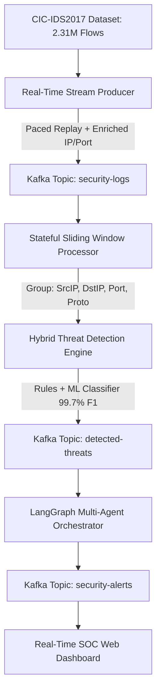
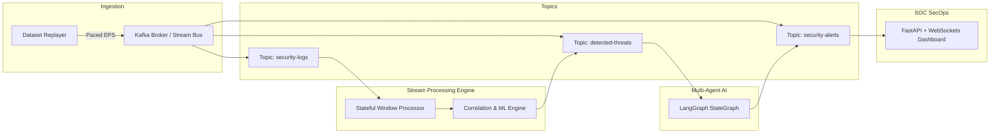
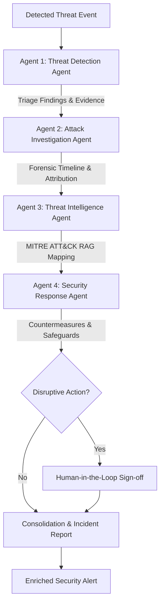

# Real-Time Cybersecurity Log Correlation with Multi-Agent AI
## Academic Project: Stream Processing and Analytics (SPA) & Agentic AI
**Benchmark Dataset:** CIC-IDS2017 Comprehensive Network-Flow Cybersecurity Dataset (2.31M Events)

---

## 1. Project Overview

This project implements an intelligent, real-time Security Operations Center (SOC) monitoring and automated threat investigation platform. It bridges two critical computing paradigms:

1. **Stream Processing and Analytics (SPA):** High-throughput, low-latency streaming pipeline using Apache Kafka topic semantics, stateful event-time sliding/tumbling windows, multi-dimensional key grouping, late-arrival/duplicate filtering, and live performance telemetry.
2. **Agentic AI:** Autonomous multi-agent cybersecurity investigation system built on **LangGraph**, featuring four specialized agents (Detection, Forensic Investigation, Threat Intelligence RAG with local MITRE ATT&CK, and Security Response with Human-in-the-Loop safeguards).

---

## 2. System Architecture Diagrams

### 2.1 End-to-End System Workflow



### 2.2 Kafka Streaming Architecture (SPA)



### 2.3 Multi-Agent AI Architecture (LangGraph)



---

## 3. Repository Structure

```
/Users/yashna/edaspa/
├── EDA/                         # Preserved Phase 1 Exploratory Data Analysis
│   ├── cybersecurity_eda.py     # EDA script on 2.31M rows
│   ├── generate_graphs.py       # Publication-quality graph generator
│   ├── EDA_Report.md            # Comprehensive EDA report
│   ├── PHASE1_EDA_SUMMARY.md    # Executive presentation summary
│   └── plots/                   # 18 generated high-res plots
├── csv/                         # Converted CSV dataset captures (8 files)
├── models/                      # Trained machine learning artifacts
│   ├── threat_detector.joblib   # Multi-class HistGradientBoosting (99.67% F1)
│   ├── scaler.joblib            # Fitted StandardScaler
│   ├── feature_columns.json     # Feature schema contract
│   └── evaluation_metrics.json  # Holdout test set metrics
├── knowledge_base/              # Local MITRE ATT&CK Enterprise Matrix
│   └── mitre_attack.json        # Verified techniques (T1110, T1046, T1498, etc.)
├── src/
│   ├── config.py                # Centralized paths, topology, and topics
│   ├── models/
│   │   ├── train_detector.py    # Stratified model training
│   │   └── feature_pipeline.py  # Cleaning, scaling, and log1p transforms
│   ├── streaming/
│   │   ├── bus.py               # Dual-mode Kafka & EmbeddedStreamBus
│   │   ├── producer.py          # Configurable real-time replayer
│   │   ├── window_processor.py  # Event-time sliding/tumbling windows
│   │   ├── metrics.py           # Throughput, latency, lag telemetry
│   │   └── pipeline.py          # End-to-end streaming coordinator
│   ├── detection/
│   │   └── engine.py            # Hybrid rule-based + ML threat detector
│   ├── agents/
│   │   ├── tools.py             # Forensic investigation tools
│   │   ├── rag.py               # Authentic MITRE ATT&CK RAG retrieval
│   │   └── orchestrator.py      # LangGraph StateGraph orchestration
│   ├── api/
│   │   └── server.py            # FastAPI + WebSocket backend
│   └── dashboard/
│       ├── index.html           # Modern SOC dashboard HTML
│       ├── styles.css           # Premium dark-mode cyber styling
│       └── app.js               # Reactive WebSocket client
├── tests/
│   ├── test_pipeline.py         # Automated regression test suite
│   └── run_performance_benchmark.py # SPA throughput & latency benchmark
├── artifacts/
│   └── sample_investigations/   # Sample incident forensic reports
├── run_system.py                # Single-command application launcher
├── requirements.txt             # Dependency declarations
├── PROJECT_IMPLEMENTATION_PLAN.md # Initial phase implementation roadmap
├── SPA_PERFORMANCE_REPORT.md    # Stream processing benchmark analysis
├── AGENTIC_AI_DOCUMENTATION.md  # 9 Agentic AI concepts in working code
└── TESTING_REPORT.md            # Ground-truth validation & test metrics
```

---

## 4. Quick Start & Execution

### 4.1 Prerequisites
- Python 3.11+
- Installed packages: `pip install -r requirements.txt`

### 4.2 Single-Command Platform Launch
To launch the real-time streaming pipeline, multi-agent orchestrator, and SOC dashboard:

```bash
python3 run_system.py
```

Open your browser and navigate to:
- **SOC Dashboard:** `http://localhost:8000`
- **Interactive REST API Docs:** `http://localhost:8000/docs`
- **Live WebSocket Feed:** `ws://localhost:8000/ws/stream`

### 4.3 Running Automated Tests
```bash
python3 tests/test_pipeline.py
```

### 4.4 Running SPA Performance Benchmarks
```bash
python3 tests/run_performance_benchmark.py
```

---

## 5. Academic Subject Highlights

### Stream Processing & Analytics (SPA)
- **Zero-Drop High-Throughput Engine:** Dual-mode architecture supporting both production Apache Kafka (`confluent-kafka`) and embedded in-memory streaming bus.
- **Event-Time Watermarking:** Handles late-arriving events within configurable tolerance (default: 5.0s) and filters duplicate flows using bounded LRU caches.
- **Multi-Dimensional Sliding Windows:** Groups events by `(src_ip, dst_ip, protocol, dst_port)` with sub-second sliding intervals.
- **Comprehensive Telemetry:** Real-time metrics for events/second (EPS), consumer lag, window aggregation latency, and end-to-end detection delay.

### Agentic AI
- **Four Specialized Autonomous Agents:**
  1. *Threat Detection Agent:* Window triage, anomaly scoring, evidence compilation.
  2. *Attack Investigation Agent:* Timeline reconstruction, forensic IP history query.
  3. *Threat Intelligence Agent:* Retrieval-Augmented Generation (RAG) against local MITRE ATT&CK database.
  4. *Security Response Agent:* Defensive prioritization and Human-in-the-Loop mitigation gates.
- **Explainability & Safeguards:** Zero hallucination of MITRE technique IDs; analyst approval required for all disruptive mitigations.
